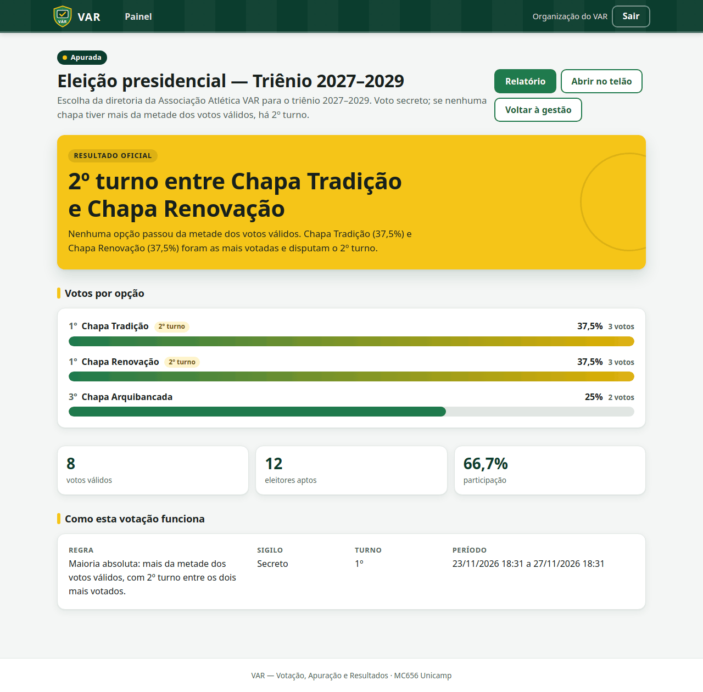

# VAR — Votação, Apuração e Resultados

Plataforma configurável de votação para o futebol: eleições de clube, assembleias de conselho e
premiações, com voto pelo celular, sigilo, auditoria e resultado na hora (MC656 — Engenharia de
Software, Unicamp).

[](https://github.com/gabicoppo/var-votacao/actions/workflows/ci.yml)



**Deploy:** `https://<seu-servico>.onrender.com` (a URL é definida ao criar o serviço no Render;
veja [docs/deploy.md](docs/deploy.md)).

## Funcionalidades

**Eleição presidencial de clube**
- Votação com pergunta, descrição, chapas, período e lista de aptos (`id;nome`).
- Voto secreto, maioria absoluta e 2º turno opcional, criado com os dois mais votados.
- Códigos de acesso por eleitor e convite com o link da cédula.

**Premiação "Craque do Campeonato"**
- Cédula Top 3 (1º = 5, 2º = 3, 3º = 1 ponto), escolhida por toque no celular.
- Grupos de votantes com pesos (ex.: jornalistas × 2, torcedores × 1).
- Ranking com pódio, pontos por grupo e critérios de desempate.

**Assembleia do conselho**
- Voto identificado (nominal), quórum mínimo e maioria qualificada (ex.: 2/3).

**Para todos os contextos**
- Ciclo rascunho → aberta → encerrada → apurada; a configuração não muda depois da abertura.
- Voto em 3 telas no celular, um voto por eleitor apto e comprovante verificável em `/verificar`.
- Gestão ao vivo (participação e lista de presença), resultado com barras, telão para projetar e
  "Momento VAR".
- Relatório de apuração (ata) com a trilha de auditoria e um código de verificação do texto.

Guia com screenshots: [docs/manual.md](docs/manual.md). Roteiro da demonstração:
[docs/demo.md](docs/demo.md).

## Como rodar

Pré-requisito: **JDK 21**. O Maven vem pelo wrapper `./mvnw`.

```bash
./mvnw spring-boot:run                         # http://localhost:8080, com dados de demonstração
./mvnw -DskipTests package                     # gera target/var-<versão>.jar
java -jar target/var-*.jar                     # roda o jar
docker build -t var-votacao . && docker run -p 8080:8080 -e VAR_SENHA_ORGANIZADOR=minha-senha var-votacao
```

Contas de demonstração:

| Papel | Usuário | Senha |
|---|---|---|
| Organizador | `organizador` | `var2026` (no perfil `prod`, a senha vem de `VAR_SENHA_ORGANIZADOR`) |
| Eleitor | `e01` a `e12` | `1234` |

Configuração (`src/main/resources/application*.properties`):

| Propriedade / variável | Padrão | Função |
|---|---|---|
| `var.demo.ativo` | `true` | Cria os dados e as contas de demonstração ao iniciar (`false` nos testes). |
| `VAR_SENHA_ORGANIZADOR` | `var2026` | Senha do organizador. No perfil `prod`, sem ela, é gerada uma senha aleatória, escrita no log. |
| `SPRING_PROFILES_ACTIVE=prod` | — | Perfil do deploy: porta de `PORT`, cookies `secure`, erros sem detalhes. |
| `PORT` | `8080` | Porta no perfil `prod`. |

Os dados ficam **em memória**: reiniciar apaga o que foi criado e restaura a demonstração.

## Como testar

```bash
./mvnw verify                                  # compila, roda os testes (domínio e web) e gera a cobertura
./mvnw verify -Pe2e                            # + testes de ponta a ponta no navegador (Playwright)
./mvnw checkstyle:check                        # lint
./mvnw compile spotbugs:check                  # análise estática
./mvnw test-compile org.pitest:pitest-maven:mutationCoverage   # teste de mutação (pacote processo)
./mvnw test -Dgroups=carga                     # só o teste de carga do RNF-03 (20.000 votos)
```

Para os E2E, é preciso um Chromium: o do Playwright (instalação descrita em
`src/test/java/br/unicamp/var/e2e/package-info.java`) ou um do sistema, com
`E2E_CHROMIUM=/caminho/do/chrome ./mvnw verify -Pe2e`.

| Relatório | Onde |
|---|---|
| Cobertura (JaCoCo) | `target/site/jacoco/index.html` |
| Mutação (PIT) | `target/pit-reports/index.html` |
| Testes | `target/surefire-reports/` (E2E: `target/failsafe-reports/`) |
| Screenshots dos E2E | `target/e2e-screenshots/` |

O CI (GitHub Actions) roda em todo PR e push para `develop` e `main` os jobs `build`, `lint`
(Checkstyle e SpotBugs), `test` (com o resumo da cobertura), `e2e` (Playwright, com os screenshots
como artefato) e `docker` (build da imagem).

## Stack e arquitetura

Java 21, Maven, Spring Boot 3.5 (Web, Thymeleaf, Security, Validation, Actuator), HTML, CSS e
JavaScript sem framework; testes com JUnit 5, Spring Test/MockMvc, Playwright, JaCoCo e PIT;
Checkstyle e SpotBugs; Docker e Render.

- **Monólito modular por funcionalidade:** núcleo de domínio em Java puro, que não conhece o
  Spring, e adaptadores web por área (`web.organizador`, `web.eleitor`, `web.resultado`,
  `web.premiacao`, `web.comum`).
- **Padrões no domínio:** State no ciclo da votação (`processo`) e Strategy nas regras de apuração
  (`apuracao`).
- **Persistência em memória** atrás das interfaces de repositório (portas), sem banco.

Detalhes, diagramas C4 e decisões (ADRs): [docs/arquitetura.md](docs/arquitetura.md).
Rastreabilidade dos requisitos: [docs/requisitos.md](docs/requisitos.md).
Histórico de entregas: [CHANGELOG.md](CHANGELOG.md).

## Fluxo de trabalho (Git)

- `main`: versões entregues (protegida); cada merge gera deploy no Render.
- `develop`: integração (protegida).
- `feature/nome-da-feature`: uma por funcionalidade, criada a partir de `develop`.
- `release/*`: preparação de versão, a partir de `develop`, com PR para `main`.

Toda mudança entra por Pull Request, com 1 aprovação de outro integrante, discussões resolvidas e
checks verdes. Cada entrega tem uma tag (`a2-v1.0.0`, `a4-v1.0.0`, `a5-v1.0.0`...).

Mensagens de commit: `tipo: descrição curta (#issue)`, por exemplo
`feat: calcula maioria absoluta (#12)`.

## Equipe

- Fabrício Karasz Novaes Silva (281168)
- Gabriela Vieira Coppo (167163)
- João Rafael Silva de Azeredo (288818)
- Juliana Travenzolli Silva Martins (245913)

## Uso de IA generativa

A equipe usou um assistente de IA generativa (Claude Code) como apoio no desenvolvimento: para
escrever código, testes e documentação a partir das tarefas definidas pelos integrantes, revisar
mudanças e investigar falhas do CI. Os integrantes definiram os requisitos, a arquitetura e as
tarefas, revisaram o que foi produzido e responderam por ele: toda mudança passou por Pull Request,
pela revisão de outro integrante e pelo CI (testes, lint, análise estática e E2E) antes de entrar
em `develop`.
