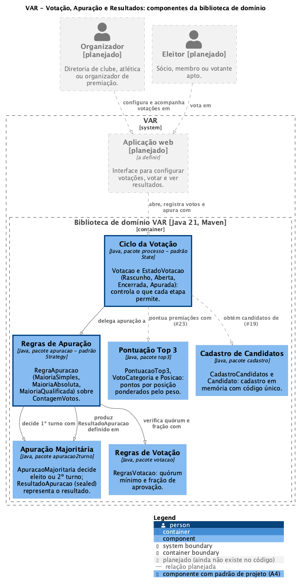

# Arquitetura do VAR

Documentação de arquitetura do VAR – Votação, Apuração e Resultados (MC656, Atividade 4).
Descreve o código da tag `a4-v1.0.0`.

## 1. Visão geral

O VAR é uma plataforma configurável para processos de votação e decisão coletiva no
futebol: eleições de clube, votações de atlética e premiações (Top 3 ponderado).

Hoje o sistema é **um único container**: uma **biblioteca de domínio Java 21 empacotada
com Maven** (`br.unicamp.var:var`, um `.jar`). Ela não tem interface de usuário, banco de
dados nem rede; quem a usa são os testes JUnit e, no futuro, uma aplicação.

Por isso os níveis 1 e 2 do C4 se reduzem a quase nada: no contexto (nível 1), o
Organizador e o Eleitor ainda não interagem com nenhum software; no nível de containers
(nível 2), só existe esta biblioteca. A aplicação web e os atores aparecem no diagrama
abaixo apenas como **planejados**, para mostrar onde a biblioteca vai se encaixar. O
nível que de fato tem conteúdo é o **nível 3 (componentes)**, documentado a seguir.

## 2. Diagrama C4 de componentes (nível 3)



- Fonte versionada: [`diagramas/c4-componentes.puml`](diagramas/c4-componentes.puml)
  (C4-PlantUML).
- Para regenerar a imagem: `java -jar plantuml.jar -tpng docs/diagramas/c4-componentes.puml`
  (o arquivo usa o layout interno `smetana`, então não precisa de Graphviz).
- Elementos e setas **tracejados e cinza** são planejados: ainda não existem no código.
  Setas sólidas correspondem a `import` reais entre pacotes em `src/main`.
- Componentes com **borda grossa** aplicam um padrão de projeto (Strategy e State, A4).

## 3. Componentes

| Componente | Pacote / classes | Responsabilidade | Relações |
|---|---|---|---|
| **Ciclo da Votação** | `processo`: `Votacao`, `EstadoVotacao` (package-private), `Rascunho`, `Aberta`, `Encerrada`, `Apurada` | Agregado com estado de uma votação (pergunta, opções, votos, regra). `Votacao` repassa cada operação (`alterarRegra`, `abrir`, `registrarVoto`, `encerrar`, `apurar`) ao estado atual, que a executa ou a recusa com `IllegalStateException`; padrão **State**. A regra só pode mudar em `Rascunho` (RNF-07). | **delega apuração a** Regras de Apuração (no estado `Encerrada`, chama a `RegraApuracao` configurada com a `ContagemVotos`); **devolve e guarda** o `ResultadoApuracao` de Apuração Majoritária (`Apurada` o mantém). |
| **Regras de Apuração** | `apuracao`: `RegraApuracao` (`@FunctionalInterface`), `MaioriaSimples`, `MaioriaAbsoluta`, `MaioriaQualificada`, `ContagemVotos` | Família de regras intercambiáveis que transformam uma `ContagemVotos` (votos por opção e total de aptos, validada no construtor) em `ResultadoApuracao`; padrão **Strategy**. | **decide 1º turno com** Apuração Majoritária (`MaioriaAbsoluta`); **verifica quórum e fração com** Regras de Votação (`MaioriaQualificada`); **produz** `ResultadoApuracao`, definido em Apuração Majoritária. |
| **Apuração Majoritária** | `apuracao2turno`: `ApuracaoMajoritaria`, `ResultadoApuracao` (sealed: `Eleito`, `SegundoTurno`, `SemVencedor`, `QuorumNaoAtingido`) | Decide se o mais votado tem maioria absoluta ou se há 2º turno entre os dois primeiros; define o tipo do resultado. Sem estado. | Não depende de outros pacotes. |
| **Regras de Votação** | `votacao`: `RegrasVotacao` | Quórum mínimo (`quorumAtingido`) e fração de aprovação sobre votos válidos (`aprovada`). Sem estado. | Não depende de outros pacotes. |
| **Pontuação Top 3** | `top3`: `PontuacaoTop3`, `VotoCategoria`, `Posicao` | Pontos por posição (1º = 5, 2º = 3, 3º = 1, definidos no enum `Posicao`), multiplicados pelo peso da categoria e somados por candidato. Sem estado. | **Isolado**: ainda não é usado por nenhum outro componente. |
| **Cadastro de Candidatos** | `cadastro`: `CadastroCandidatos`, `Candidato` | Cadastro em memória de candidatos com código único; `Candidato` se valida no construtor. | **Isolado**: ainda não é usado por nenhum outro componente. |

**Componentes ainda isolados.** Cadastro de Candidatos e Pontuação Top 3 já têm regras
implementadas e testadas, mas nenhum outro pacote os importa. A integração está prevista
nas histórias:

- [#19](https://github.com/gabicoppo/var-votacao/issues/19) (Criar votação com pergunta,
  opções/candidatos e descrição): a `Votacao` passa a obter suas opções do Cadastro de
  Candidatos;
- [#23](https://github.com/gabicoppo/var-votacao/issues/23) (Configurar premiação Top 3
  com pesos por grupo): o ciclo da votação passa a pontuar premiações com a Pontuação Top 3.

Essas duas relações aparecem tracejadas no diagrama.

## 4. Estilo arquitetural

**Monólito modular organizado por funcionalidade.** Todo o sistema é um único artefato
(`.jar`), gerado por um único `pom.xml`. Dentro dele, os pacotes são cortados por
funcionalidade de negócio (package-by-feature: `processo`, `apuracao`, `votacao`,
`apuracao2turno`, `top3`, `cadastro`), e não por camada técnica (`model`, `service`,
`controller`). Cada pacote corresponde a um componente do diagrama.

**Núcleo de domínio puro.** O código contém só regras de negócio:

- **regras sem estado**: `RegrasVotacao`, `ApuracaoMajoritaria` e `PontuacaoTop3` são
  classes `final` com métodos estáticos e funções puras (entrada → saída);
- **estratégias** pequenas e imutáveis, implementando `RegraApuracao`;
- **um agregado com estado**: `Votacao`, cujas transições são controladas pelo State;
- **valores imutáveis**: `record`s como `Candidato`, `VotoCategoria`, `ContagemVotos` e os
  casos de `ResultadoApuracao`;
- **nenhuma dependência de infraestrutura**: o `pom.xml` só declara JUnit, com escopo de
  teste.

**Dependências unidirecionais.** As relações sólidas do diagrama vêm dos imports entre
pacotes e formam um grafo acíclico:

```
processo ──► apuracao ──► apuracao2turno
   │                 └──► votacao
   └────────────────────► apuracao2turno   (tipo ResultadoApuracao)
cadastro, top3: sem dependências entre pacotes
```

Os componentes de baixo nível (`votacao`, `apuracao2turno`) não conhecem quem os usa, e
o componente com estado (`processo`) fica no topo. Assim, uma regra pode ser testada
sozinha, e uma nova regra de apuração entra sem tocar no ciclo da votação.

**O que ainda não temos.** Não há camada de apresentação, de persistência nem de
integração, e portanto também não há arquitetura em camadas completa nem arquitetura
hexagonal. A evolução natural é para **portas e adaptadores**: o núcleo atual vira o
hexágono, com portas definidas por ele (ex.: um repositório de votações e um serviço de
autenticação de eleitor, necessários para RNF-02 e RNF-05), e a aplicação web e o banco
entram como adaptadores, sem mudar as regras.

## 5. Decisões arquiteturais

### ADR-1: Domínio em Java puro, sem framework, banco ou UI nesta fase

- **Contexto.** As atividades até aqui pedem regras de negócio testadas (quórum,
  maioria, 2º turno, Top 3) e pipeline de CI. A tecnologia da aplicação final (web,
  banco, autenticação) ainda não foi escolhida.
- **Decisão.** Implementar o VAR como biblioteca Java 21 sem dependências de execução,
  validada só por testes JUnit, Checkstyle e SpotBugs no CI.
- **Alternativas consideradas.** Começar com um framework web (ex.: Spring Boot) e banco
  desde o início; ou fazer um protótipo de interface antes das regras.
- **Consequências e trade-offs.**
  - (+) As regras são testáveis com JUnit puro, sem mocks nem contêineres. O CI fica
    rápido e o build, reprodutível.
  - (+) As regras de domínio são validadas antes de comprometer o projeto com uma
    tecnologia de infraestrutura.
  - (−) Ainda não há aplicação executável: nenhum usuário consegue votar.
  - (−) A integração fica adiada, e os RNFs que dependem dela (RNF-03 tempo de resultado,
    RNF-05 autenticação, RNF-01 sigilo no transporte e no armazenamento) ainda não são
    verificáveis.

### ADR-2: Pacotes por funcionalidade em vez de camadas técnicas

- **Contexto.** Quatro pessoas trabalham em paralelo, cada uma numa funcionalidade, com
  uma branch `feature/*` por história e PRs revisados para `develop`.
- **Decisão.** Organizar o código em um pacote por funcionalidade (`cadastro`,
  `votacao`, `apuracao2turno`, `top3`, `apuracao`, `processo`), cada um com suas classes e
  testes.
- **Alternativas consideradas.** Pacotes por camada técnica (`model`, `service`, `util`),
  ou um único pacote `br.unicamp.var`.
- **Consequências e trade-offs.**
  - (+) Cada história mexe em poucos pacotes e cada pacote tem coesão alta. A equipe
    trabalha em paralelo quase sem conflitos de merge (as três branches da A4 tocam
    pacotes diferentes).
  - (+) A estrutura de pastas mostra o que o sistema faz, e cada pacote vira um
    componente do C4 sem tradução.
  - (−) Regras comuns podem se duplicar entre pacotes. Exemplo: o cálculo de proporção
    `(double) parte / total` comparado a um limiar aparece em `RegrasVotacao` e em
    `ApuracaoMajoritaria` (code smell documentado na A4).
  - (−) Os nomes dos pacotes ficam presos à feature que os criou. `apuracao2turno` hoje
    abriga o `ResultadoApuracao` usado por todas as regras de apuração, não só pelo 2º
    turno.

### ADR-3: Resultados como tipos algébricos (`sealed interface` + `record`)

- **Contexto.** Uma apuração pode terminar de formas diferentes, cada uma com dados
  próprios: alguém foi eleito, há 2º turno entre dois candidatos, não houve vencedor ou o
  quórum não foi atingido.
- **Decisão.** Representar o resultado como `sealed interface ResultadoApuracao`, com um
  `record` por caso (`Eleito`, `SegundoTurno`, `SemVencedor`, `QuorumNaoAtingido`).
- **Alternativas consideradas.** Retornar `boolean` ou `String` (código de status);
  lançar exceções para casos "sem vencedor"; ou usar uma classe única com campos
  opcionais/nulos.
- **Consequências e trade-offs.**
  - (+) O compilador ajuda a tratar todos os casos: um `switch` sobre
    `ResultadoApuracao` sem `default` deixa de compilar se faltar um caso.
  - (+) O resultado é imutável e se explica sozinho: cada caso carrega só os dados que
    fazem sentido para ele (ex.: `SegundoTurno` tem os dois colocados).
  - (−) Exige Java 17+ (o projeto usa 21).
  - (−) Incluir um caso novo obriga a revisar todos os consumidores; foi o que aconteceu
    ao adicionar `SemVencedor` e `QuorumNaoAtingido` para as regras do Strategy.

## 6. Rastreabilidade

| Item | Issue | PR |
|---|---|---|
| Strategy: regra de apuração intercambiável (`apuracao`) | [#36](https://github.com/gabicoppo/var-votacao/issues/36) | [#38](https://github.com/gabicoppo/var-votacao/pull/38) |
| State: ciclo de vida da votação (`processo`) | [#37](https://github.com/gabicoppo/var-votacao/issues/37) | [#39](https://github.com/gabicoppo/var-votacao/pull/39) |
| Refatoração: enum `Posicao` no Top 3 | [#33](https://github.com/gabicoppo/var-votacao/issues/33) | [#34](https://github.com/gabicoppo/var-votacao/pull/34) |
| Esta documentação | [#35](https://github.com/gabicoppo/var-votacao/issues/35) | [#40](https://github.com/gabicoppo/var-votacao/pull/40) |

Histórias relacionadas: [#21](https://github.com/gabicoppo/var-votacao/issues/21)
(Escolher a regra de apuração, Strategy), [#19](https://github.com/gabicoppo/var-votacao/issues/19)
(votação em "rascunho" até ser aberta, State) e
[#23](https://github.com/gabicoppo/var-votacao/issues/23) (Top 3 com pesos).
