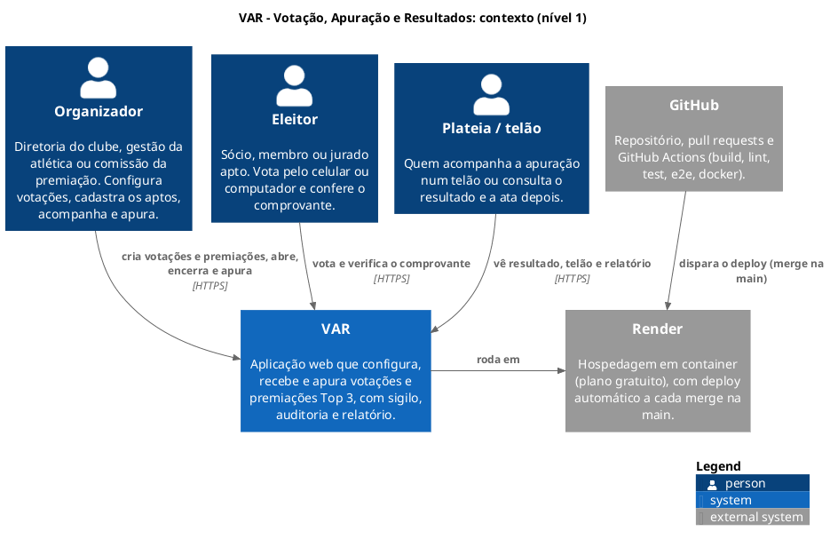
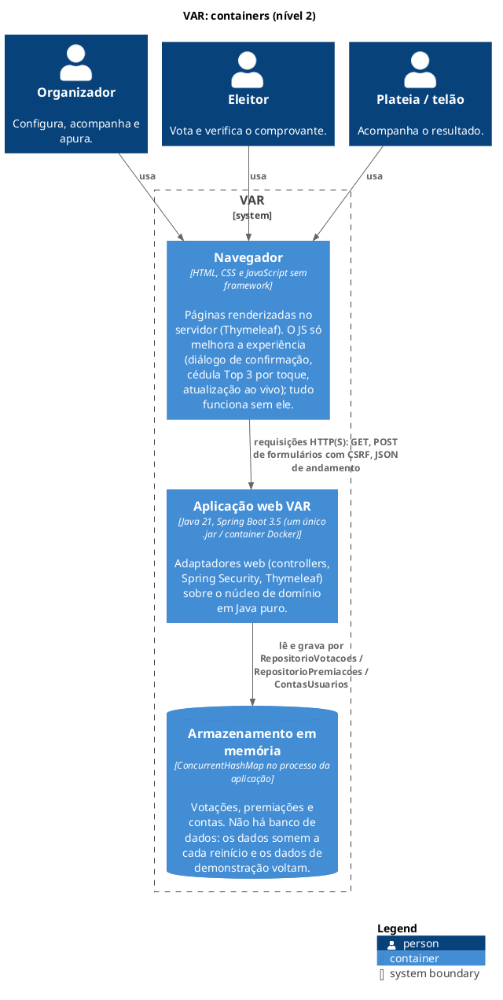
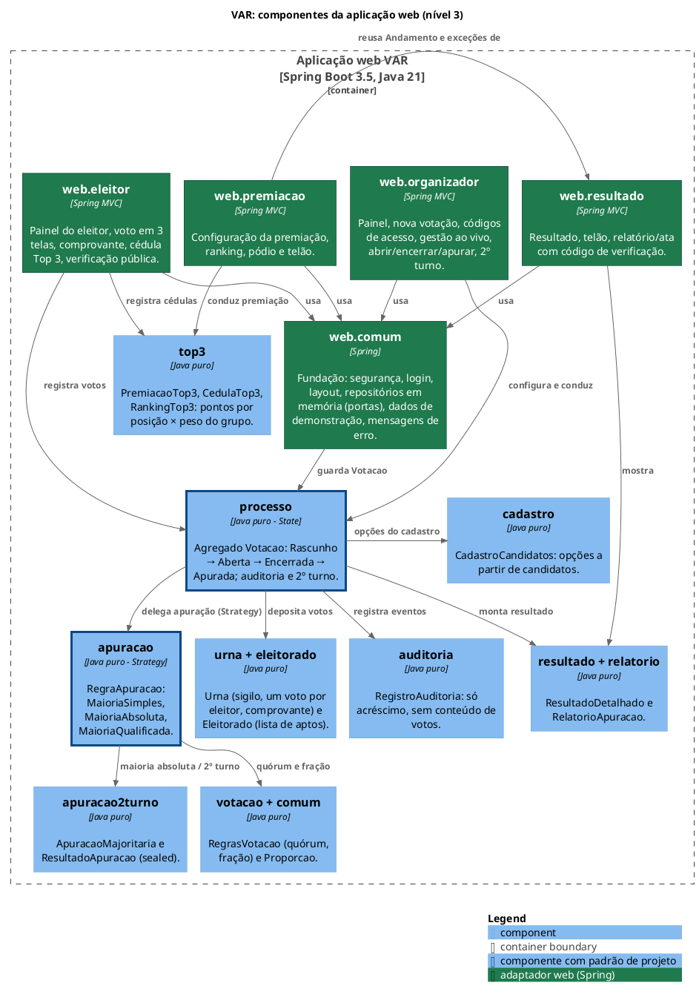

# Arquitetura do VAR

Documentação de arquitetura do VAR – Votação, Apuração e Resultados (MC656), na **versão final**:
uma aplicação web Spring Boot sobre o núcleo de domínio em Java puro, publicada em container.

A versão anterior deste documento (tag `a4-v1.0.0`, atualizada na `a5-v1.0.0`) descrevia só a
biblioteca de domínio, com a aplicação web como "planejada". As decisões daquela fase continuam
nos ADR-1 a ADR-3; as da fase web estão nos ADR-4 a ADR-8.

## 1. Visão geral e evolução

O VAR é uma plataforma configurável de votação para o futebol: eleição presidencial de clube
(voto secreto, maioria absoluta, 2º turno), premiação "Craque do Campeonato" (Top 3 ponderado) e
assembleia de conselho (voto nominal, quórum e maioria qualificada).

| Entrega | O que existia |
|---|---|
| `a2-v1.0.0` | Regras isoladas: cadastro de candidatos, quórum e maioria qualificada, 2º turno, Top 3 ponderado. |
| `a4-v1.0.0` | Biblioteca de domínio com os padrões **State** (`processo`) e **Strategy** (`apuracao`) e o C4 de componentes. |
| `a5-v1.0.0` | Testes por classes de equivalência e valor limite, PIT e resultado detalhado. |
| Versão final | Domínio completo (urna, eleitorado, auditoria, 2º turno, relatório, premiação) e **aplicação web** (Spring Boot, Thymeleaf, Spring Security), E2E e deploy em container. |

## 2. C4 nível 1: contexto

- **Organizador**: diretoria do clube, gestão da atlética ou comissão da premiação. Cria votações e
  premiações, cadastra os aptos, entrega os códigos de acesso, acompanha a participação, encerra e
  apura.
- **Eleitor**: sócio, membro ou jurado apto. Vota pelo celular ou computador e confere o
  comprovante.
- **Plateia / telão**: acompanha o resultado projetado e consulta o resultado e a ata depois.
- **Render**: hospeda o container; cada merge na `main` dispara um deploy ([deploy.md](deploy.md)).
- **GitHub**: repositório, pull requests e GitHub Actions (`build`, `lint`, `test`, `e2e`,
  `docker`).

## 3. C4 nível 2: containers

| Container | Tecnologia | Responsabilidade |
|---|---|---|
| Navegador | HTML, CSS e JavaScript sem framework | Mostra as páginas renderizadas no servidor. O JS (`static/js/*.js`) só melhora a experiência: diálogo de confirmação, cédula Top 3 por toque, atualização ao vivo da participação. Tudo funciona sem ele. |
| Aplicação web VAR | Java 21, Spring Boot 3.5, um único `.jar` (e uma imagem Docker) | Adaptadores web (controllers, Spring Security, Thymeleaf) e o núcleo de domínio. |
| Armazenamento em memória | `ConcurrentHashMap` dentro da aplicação | Votações, premiações e contas. **Não há banco de dados**: os dados somem a cada reinício, e os dados de demonstração voltam (ADR-5). |

## 4. C4 nível 3: componentes

### 4.1 Núcleo de domínio (Java puro, sem Spring)

| Pacote | Classes principais | Responsabilidade |
|---|---|---|
| `processo` | `Votacao`, `EstadoVotacao` (package-private), `Rascunho`, `Aberta`, `Encerrada`, `Apurada`, `PeriodoVotacao` | Agregado da votação, com ciclo controlado pelo padrão **State**. Também cuida do período (abre e encerra pelo relógio), da auditoria e do 2º turno. |
| `apuracao` | `RegraApuracao`, `MaioriaSimples`, `MaioriaAbsoluta`, `MaioriaQualificada`, `ContagemVotos` | Regras de apuração intercambiáveis (padrão **Strategy**). |
| `apuracao2turno` | `ApuracaoMajoritaria`, `ResultadoApuracao` (sealed) | Maioria absoluta e escolha dos dois colocados; o tipo do resultado (ADR-3). |
| `votacao`, `comum` | `RegrasVotacao`, `Proporcao` | Quórum e fração de aprovação; a proporção `parte/total` comparada a um limiar. |
| `urna` | `Urna`, `Comprovante`, `Sigilo` | Recebe os votos: só aptos, um por eleitor, comprovante com código. No voto secreto, guarda a presença separada da contagem. |
| `eleitorado` | `Eleitorado`, `Eleitor` | Lista de aptos, inclusive a importação `id;nome`. |
| `resultado`, `relatorio` | `ResultadoDetalhado`, `RelatorioApuracao` | Votos absolutos, percentuais e situação; relatório textual com a auditoria. |
| `auditoria` | `RegistroAuditoria`, `EventoAuditoria`, `TipoEvento` | Trilha só de acréscimo, com data/hora e autor. Não existe evento de voto (RNF-01). |
| `top3` | `PremiacaoTop3`, `CedulaTop3`, `RankingTop3`, `CategoriaEleitor`, `Posicao` | Premiação Top 3: 1º = 5, 2º = 3, 3º = 1 ponto, multiplicados pelo peso do grupo; ranking com critérios e desempate. |
| `cadastro` | `CadastroCandidatos`, `Candidato` | Opções da votação a partir de um cadastro de candidatos. |

### 4.2 Adaptadores web (`br.unicamp.var.web.*`, Spring)

| Pacote | Responsabilidade |
|---|---|
| `web.comum` | Fundação: segurança (login por formulário, papéis, CSRF), layout e design system, repositórios em memória (as **portas** `RepositorioVotacoes` e `RepositorioPremiacoes`), contas e códigos de acesso, dados de demonstração, tradução das mensagens de erro do domínio, atualizador agendado dos períodos. |
| `web.organizador` | Painel, nova votação (com importação de aptos), códigos de acesso, gestão ao vivo (presença, convite, auditoria), abrir/encerrar/apurar, troca de regra em rascunho, 2º turno, duplicar votação. |
| `web.eleitor` | Painel do eleitor, voto em 3 telas (cédula → revisão → comprovante), cédula Top 3, verificação pública de comprovante. |
| `web.resultado` | Resultado com barras e situação, telão, relatório/ata com código de verificação, andamento em JSON. |
| `web.premiacao` | Configuração da premiação, gestão, ranking com pódio, telão. |

### 4.3 Dependências reais entre pacotes

Gerada a partir dos `import br.unicamp.var...` do código (`src/main/java`), na versão final:

| Pacote | Importa |
|---|---|
| `apuracao` | `apuracao2turno`, `votacao` |
| `apuracao2turno` | `comum` |
| `auditoria` | — |
| `cadastro` | — |
| `comum` | — |
| `eleitorado` | — |
| `processo` | `apuracao`, `apuracao2turno`, `auditoria`, `cadastro`, `eleitorado`, `resultado`, `urna` |
| `relatorio` | `auditoria`, `processo`, `urna` |
| `resultado` | `apuracao`, `apuracao2turno` |
| `top3` | — |
| `urna` | `eleitorado` |
| `votacao` | `comum` |
| `web.comum` | `apuracao`, `eleitorado`, `processo`, `top3`, `urna` |
| `web.eleitor` | `processo`, `top3`, `urna`, `web.comum` |
| `web.organizador` | `apuracao`, `apuracao2turno`, `auditoria`, `eleitorado`, `processo`, `top3`, `urna`, `web.comum` |
| `web.premiacao` | `eleitorado`, `top3`, `web.comum`, `web.resultado` |
| `web.resultado` | `apuracao`, `apuracao2turno`, `processo`, `relatorio`, `resultado`, `urna`, `web.comum` |

O grafo é **acíclico**, e **nenhum pacote do domínio importa `web`**: o domínio não conhece o
Spring. `relatorio` fica acima de `processo` justamente para não criar o ciclo
`processo ↔ resultado`. A única dependência entre fatias web é `web.premiacao → web.resultado`: a premiação
reusa o `Andamento` (participação ao vivo, também em JSON) e as exceções de acesso negado e de
recurso não encontrado.

### 4.4 Uma requisição de ponta a ponta: o voto

1. O eleitor confirma o voto: `POST /eleitor/votacoes/{id}/voto` (formulário com token CSRF).
2. O Spring Security confere a sessão e o papel `ELEITOR`; o `VotoEleitorController` repassa ao
   `ServicoVotoEleitor`.
3. O serviço busca a `Votacao` em `RepositorioVotacoes` e, dentro de `synchronized (votacao)`
   (`Votacao` não é thread-safe), confere se o eleitor é apto e chama `votacao.registrarVoto(...)`.
4. A `Votacao` aplica o relógio ao período e delega ao estado atual. Só o estado `Aberta` aceita o
   voto; os outros lançam `IllegalStateException`. A `Urna` recusa não aptos (RNF-05) e voto
   duplicado (RNF-02) e devolve o `Comprovante`.
5. O controller faz POST → redirect → GET para a tela do comprovante, que mostra o código **uma
   vez** e nunca a opção escolhida (RNF-01). Erros do domínio viram frases em pt-BR pelo
   `MensagensErro`.

## 5. Estilo arquitetural

**Monólito modular organizado por funcionalidade.** Um único artefato (`.jar` / imagem Docker),
gerado por um único `pom.xml`. Os pacotes são cortados por funcionalidade de negócio, tanto no
domínio quanto na web (ADR-2).

**Portas e adaptadores, concretizado.** A A4 previa esta evolução; na versão final ela aconteceu:

- o **núcleo de domínio** é Java puro: regras sem estado, estratégias imutáveis, agregados com
  estado (`Votacao`, `PremiacaoTop3`) e valores imutáveis (`record`, `sealed`);
- a **camada web** é o adaptador de entrada: controllers finos chamam serviços e montam *view
  models* (records com tudo calculado para a tela);
- **`RepositorioVotacoes`, `RepositorioPremiacoes` e `ContasUsuarios`** são as portas de saída,
  hoje com implementações em memória (ADR-5); um banco entra como outro adaptador, sem mudar o
  domínio.

**Padrões de projeto, onde resolvem um problema concreto:**

- **State (`processo`).** Cada operação da `Votacao` (`alterarRegra`, `abrir`, `registrarVoto`,
  `encerrar`, `apurar`) é repassada ao estado atual. Por padrão, toda operação é proibida e lança
  `IllegalStateException`; cada estado libera só o que permite. Por isso a regra só muda em
  rascunho e a configuração fica congelada depois da abertura (RNF-07), sem `if`s espalhados pela
  classe.
- **Strategy (`apuracao`).** A regra é escolhida no formulário (`ConversorFormularioVotacao`
  converte "simples", "absoluta" ou "qualificada" num `RegraApuracao`) e guardada na votação; o
  estado `Encerrada` só chama `regra.apurar(contagem)`. Uma regra nova é uma classe nova, sem
  mexer no ciclo da votação, e cada regra se descreve em pt-BR (`descricao()`) para a tela e o
  relatório.

## 6. Decisões arquiteturais

### ADR-1: Domínio em Java puro, sem framework, banco ou UI nesta fase

> **Status: substituído em parte pelo ADR-4.** O domínio continua em Java puro, sem framework, e
> o que vale para ele continua valendo. A "ausência de aplicação executável" deixou de existir:
> a web entrou como adaptador (ADR-4), e o banco foi substituído por portas em memória (ADR-5).

- **Contexto.** As atividades até aqui pedem regras de negócio testadas (quórum,
  maioria, 2º turno, Top 3) e pipeline de CI. A tecnologia da aplicação final (web,
  banco, autenticação) ainda não foi escolhida.
- **Decisão.** Implementar o VAR como biblioteca Java 21 sem dependências de execução,
  validada só por testes JUnit, Checkstyle e SpotBugs no CI.
- **Alternativas consideradas.** Começar com um framework web (ex.: Spring Boot) e banco
  desde o início; ou fazer um protótipo de interface antes das regras.
- **Consequências e trade-offs.**
  - (+) As regras são testáveis com JUnit puro, sem mocks nem contêineres. O CI fica
    rápido e o build, reprodutível.
  - (+) As regras de domínio são validadas antes de comprometer o projeto com uma
    tecnologia de infraestrutura.
  - (−) Ainda não há aplicação executável: nenhum usuário consegue votar.
  - (−) A integração fica adiada, e os RNFs que dependem dela (RNF-03 tempo de resultado,
    RNF-05 autenticação, RNF-01 sigilo no transporte e no armazenamento) ainda não são
    verificáveis.

### ADR-2: Pacotes por funcionalidade em vez de camadas técnicas

- **Contexto.** Quatro pessoas trabalham em paralelo, cada uma numa funcionalidade, com
  uma branch `feature/*` por história e PRs revisados para `develop`.
- **Decisão.** Organizar o código em um pacote por funcionalidade (`cadastro`,
  `votacao`, `apuracao2turno`, `top3`, `apuracao`, `processo`), cada um com suas classes e
  testes. Na fase web, a mesma regra valeu para os adaptadores: uma fatia por área
  (`web.organizador`, `web.eleitor`, `web.resultado`, `web.premiacao`) e uma fundação comum
  (`web.comum`).
- **Alternativas consideradas.** Pacotes por camada técnica (`model`, `service`, `util`),
  ou um único pacote `br.unicamp.var`.
- **Consequências e trade-offs.**
  - (+) Cada história mexe em poucos pacotes e cada pacote tem coesão alta. A equipe
    trabalha em paralelo quase sem conflitos de merge; na fase web, cada pessoa ficou
    com uma fatia vertical.
  - (+) A estrutura de pastas mostra o que o sistema faz, e cada pacote vira um
    componente do C4 sem tradução.
  - (−) Regras comuns podem se duplicar entre pacotes. Exemplo: o cálculo de proporção
    `(double) parte / total` comparado a um limiar aparecia em `RegrasVotacao` e em
    `ApuracaoMajoritaria` (code smell documentado na A4). Foi resolvido com Extract Class
    (`comum.Proporcao`, PR #57).
  - (−) Os nomes dos pacotes ficam presos à feature que os criou. `apuracao2turno`
    abriga o `ResultadoApuracao` usado por todas as regras de apuração, não só pelo 2º
    turno.

### ADR-3: Resultados como tipos algébricos (`sealed interface` + `record`)

- **Contexto.** Uma apuração pode terminar de formas diferentes, cada uma com dados
  próprios: alguém foi eleito, há 2º turno entre dois candidatos, não houve vencedor ou o
  quórum não foi atingido.
- **Decisão.** Representar o resultado como `sealed interface ResultadoApuracao`, com um
  `record` por caso (`Eleito`, `SegundoTurno`, `SemVencedor`, `QuorumNaoAtingido`).
- **Alternativas consideradas.** Retornar `boolean` ou `String` (código de status);
  lançar exceções para casos "sem vencedor"; ou usar uma classe única com campos
  opcionais/nulos.
- **Consequências e trade-offs.**
  - (+) O compilador ajuda a tratar todos os casos: um `switch` sobre
    `ResultadoApuracao` sem `default` deixa de compilar se faltar um caso. É assim que
    `ResultadoDetalhado` monta o texto da situação.
  - (+) O resultado é imutável e se explica sozinho: cada caso carrega só os dados que
    fazem sentido para ele (ex.: `SegundoTurno` tem os dois colocados, que viram as opções
    do 2º turno).
  - (−) Exige Java 17+ (o projeto usa 21).
  - (−) Incluir um caso novo obriga a revisar todos os consumidores; foi o que aconteceu
    ao adicionar `SemVencedor` e `QuorumNaoAtingido` para as regras do Strategy.

### ADR-4: Spring Boot + Thymeleaf com renderização no servidor, em vez de SPA

- **Contexto.** Faltava a aplicação executável (ADR-1). Organizadores e eleitores usam celular e
  computador (RNF-04), a equipe já domina Java, o prazo é curto e o domínio já estava pronto e
  testado.
- **Decisão.** Uma aplicação Spring Boot 3.5 com páginas renderizadas no servidor (Thymeleaf),
  Spring Security para login e papéis, e JavaScript puro só como melhoria progressiva. A web é um
  adaptador sobre o domínio, que continua sem Spring.
- **Alternativas consideradas.** SPA (React ou Vue) com API REST; JavaFX ou aplicativo nativo;
  servlets/JSP sem framework.
- **Consequências e trade-offs.**
  - (+) Uma só linguagem, um só build e um só artefato; o domínio é chamado diretamente, sem
    camada de API nem DTOs duplicados.
  - (+) Formulários com CSRF, sessão e papéis vêm prontos do Spring Security; as páginas
    funcionam sem JavaScript e carregam rápido no celular.
  - (+) Controllers testáveis com MockMvc, sem navegador; o navegador real fica com os E2E
    (ADR-7).
  - (−) A interação ao vivo é limitada: o andamento é atualizado por *polling* de JSON, e não por
    push.
  - (−) Não há API pública para outros clientes (ex.: um aplicativo).

### ADR-5: Persistência em memória atrás de interfaces de repositório (portas)

- **Contexto.** A entrega é uma demonstração, e as regras de domínio já guardam o estado nos
  agregados. Um banco exigiria mapeamento objeto-relacional de `Votacao` (State, urna, auditoria)
  e infraestrutura no deploy.
- **Decisão.** A web acessa os dados só pelas interfaces `RepositorioVotacoes`,
  `RepositorioPremiacoes` e `ContasUsuarios`, hoje implementadas em memória com
  `ConcurrentHashMap`. `Votacao` não é thread-safe: toda leitura e escrita na web acontece dentro
  de `synchronized (votacao)`.
- **Alternativas consideradas.** JPA com H2 ou PostgreSQL desde já; arquivos JSON em disco.
- **Consequências e trade-offs.**
  - (+) Zero infraestrutura: o `.jar` sobe sozinho, os testes não precisam de banco, e o deploy
    gratuito funciona.
  - (+) A porta isola o domínio: trocar por JPA é criar outra implementação das interfaces, sem
    tocar em controllers nem no domínio.
  - (−) **Os dados somem a cada reinício ou deploy.** Para a demo, os dados de demonstração voltam
    sozinhos.
  - (−) Uma única instância: não escala horizontalmente, e a sincronização por objeto basta só
    para esta carga.
  - **Caminho para JPA:** entidades separadas do domínio (ou mapeamento do estado com um campo
    `status`), um adaptador `RepositorioVotacoesJpa` e transações no lugar do
    `synchronized`.

### ADR-6: Sessão com códigos de acesso para os eleitores; verificação forte de identidade adiada

- **Contexto.** Só aptos podem votar (RNF-05). A elicitação mostrou expectativas opostas: o sócio
  do clube só aceitaria votar pelo celular com verificação forte (D2), e grupos pequenos não
  temem fraude e querem algo simples (D21).
- **Decisão.** Login por formulário com sessão do Spring Security. Cada eleitor novo cadastrado
  numa votação ganha uma conta, com login igual ao id da lista e um **código de acesso** de 8
  caracteres aleatórios (sem caracteres ambíguos), mostrado ao organizador **uma única vez** para
  ser entregue. Senhas e códigos são guardados como hash BCrypt. A verificação reforçada de
  identidade (#27) ficou para depois.
- **Alternativas consideradas.** Biometria ou reconhecimento facial; link mágico por e-mail ou
  SMS; integração com um provedor de identidade (OAuth).
- **Consequências e trade-offs.**
  - (+) Atende grupos pequenos e a demonstração sem serviços externos, custos ou dados pessoais
    extras.
  - (+) A urna confere a aptidão a cada voto, então um código vazado não permite votar em outra
    votação nem votar duas vezes.
  - (−) Quem tiver o código de outra pessoa vota por ela: não atende o nível de confiança pedido
    em D2 para a eleição do clube.
  - (−) A entrega dos códigos é manual (CSV ou impressão).

### ADR-7: Testes de ponta a ponta com Playwright num perfil Maven separado

- **Contexto.** MockMvc testa controllers e HTML, mas não executa JavaScript nem CSS: não pega
  rolagem horizontal no celular (RNF-04), o diálogo de confirmação nem a cédula Top 3 por toque.
- **Decisão.** Testes E2E com Playwright Java contra a aplicação real (porta aleatória, dados de
  demonstração, Chromium), em classes `*E2E` rodadas pelo `maven-failsafe-plugin` só no perfil
  `e2e`, com seletores por papel e texto.
- **Alternativas consideradas.** Selenium; Playwright em Node; rodar os E2E no `verify` normal.
- **Consequências e trade-offs.**
  - (+) Verificam no navegador o roteiro da demo, os RNF-02/04/05, o 2º turno, a premiação, o
    diálogo e a acessibilidade básica, e geram screenshots como evidência.
  - (+) O `./mvnw verify` do dia a dia continua rápido; o CI roda os E2E num job próprio.
  - (−) Mais lentos (cerca de 1,5 min no CI) e dependentes de um navegador instalado.
  - (−) Dependem dos textos das telas: mudar um rótulo exige atualizar o E2E no mesmo PR.

### ADR-8: Deploy em container no Render, com deploy automático na `main`

- **Contexto.** A Atividade 1 prometeu deploy automático depois do merge na `main`. A aplicação é
  um único `.jar`, sem banco (ADR-5), e o orçamento é zero.
- **Decisão.** Imagem Docker em dois estágios (build com Maven, execução com JRE e usuário não
  root), publicada no Render pelo blueprint `render.yaml` (`autoDeploy` na `main`, health check em
  `/actuator/health`). Perfil `prod` com cookies `secure`, cabeçalhos do proxy e senha do
  organizador por variável de ambiente. O CI faz `docker build` em todo PR.
- **Alternativas consideradas.** Railway ou Fly.io; VM própria; GitHub Pages (não serve
  aplicações Java).
- **Consequências e trade-offs.**
  - (+) Cada release na `main` vai ao ar sem passos manuais; o mesmo `Dockerfile` roda localmente.
  - (+) Plano gratuito, sem cartão.
  - (−) O plano gratuito dorme sem acesso (primeiro acesso lento) e tem 512 MB de RAM.
  - (−) Com a memória volátil (ADR-5), cada deploy ou reinício apaga os dados criados.

## 7. Rastreabilidade

| Item | Issue | PR |
|---|---|---|
| Strategy: regra de apuração intercambiável (`apuracao`) | [#36](https://github.com/gabicoppo/var-votacao/issues/36) | [#38](https://github.com/gabicoppo/var-votacao/pull/38) |
| State: ciclo de vida da votação (`processo`) | [#37](https://github.com/gabicoppo/var-votacao/issues/37) | [#39](https://github.com/gabicoppo/var-votacao/pull/39) |
| Refatoração: enum `Posicao` no Top 3 | [#33](https://github.com/gabicoppo/var-votacao/issues/33) | [#34](https://github.com/gabicoppo/var-votacao/pull/34) |
| Resultado detalhado com votos e percentuais (`resultado`) | [#49](https://github.com/gabicoppo/var-votacao/issues/49) | [#50](https://github.com/gabicoppo/var-votacao/pull/50) |
| Documentação C4 da A4 | [#35](https://github.com/gabicoppo/var-votacao/issues/35) | [#40](https://github.com/gabicoppo/var-votacao/pull/40) |
| `Proporcao`, descrição das regras e auditoria | — | [#57](https://github.com/gabicoppo/var-votacao/pull/57) |
| Domínio da urna, eleitorado, 2º turno e premiação | #22, #24, #23 | [#58](https://github.com/gabicoppo/var-votacao/pull/58) a [#62](https://github.com/gabicoppo/var-votacao/pull/62), [#64](https://github.com/gabicoppo/var-votacao/pull/64) |
| Fundação web (ADR-4, ADR-5, ADR-6) | — | [#63](https://github.com/gabicoppo/var-votacao/pull/63), [#65](https://github.com/gabicoppo/var-votacao/pull/65) |
| Áreas web (organizador, eleitor, resultados) | #19 a #31 | [#66](https://github.com/gabicoppo/var-votacao/pull/66) a [#68](https://github.com/gabicoppo/var-votacao/pull/68), [#70](https://github.com/gabicoppo/var-votacao/pull/70) a [#73](https://github.com/gabicoppo/var-votacao/pull/73) |
| Teste de carga do RNF-03 | #29 | [#69](https://github.com/gabicoppo/var-votacao/pull/69) |
| Testes E2E (ADR-7) | — | [#74](https://github.com/gabicoppo/var-votacao/pull/74) |
| Deploy (ADR-8) | — | [#75](https://github.com/gabicoppo/var-votacao/pull/75) |

A rastreabilidade de cada história e RNF até o código e os testes está em
[requisitos.md](requisitos.md).
