# Manual de uso do VAR

Guia das telas da versão final, com os dados de demonstração (`./mvnw spring-boot:run` e
`http://localhost:8080`). Contas: organizador `organizador` / `var2026` (no deploy, a senha vem de
`VAR_SENHA_ORGANIZADOR`); eleitores `e01` a `e12` / `1234`.

As telas do eleitor foram capturadas a 360 px (celular) e as demais a 1280 px.

## 1. Início e login

| Página inicial | Login |
|---|---|
| 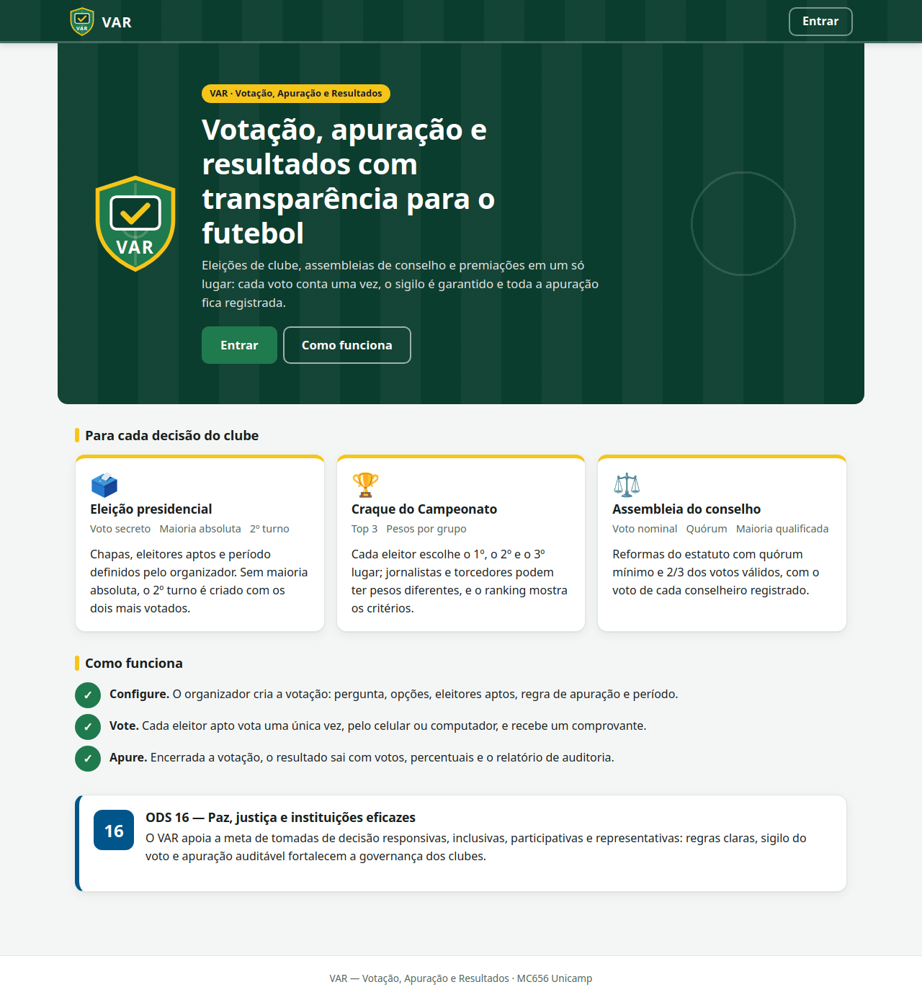 | 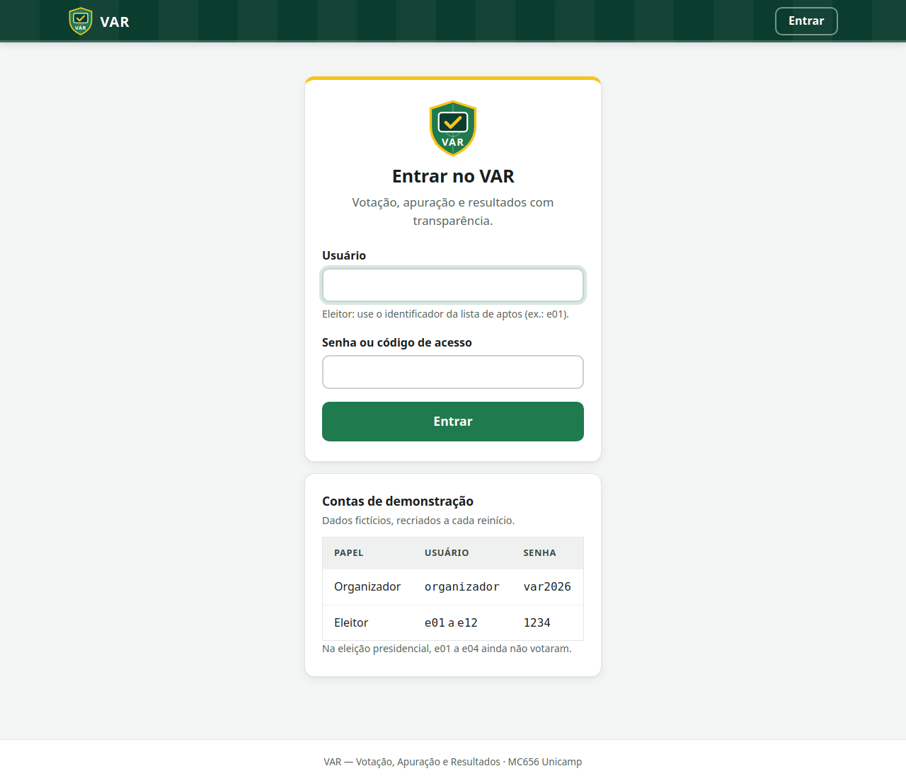 |

A página inicial (`/`) é pública e apresenta os três contextos: eleição presidencial, Craque do
Campeonato e assembleia do conselho. Depois do login, o organizador vai para `/organizador` e o
eleitor, para `/eleitor`.

## 2. Organizador

### 2.1 Painel

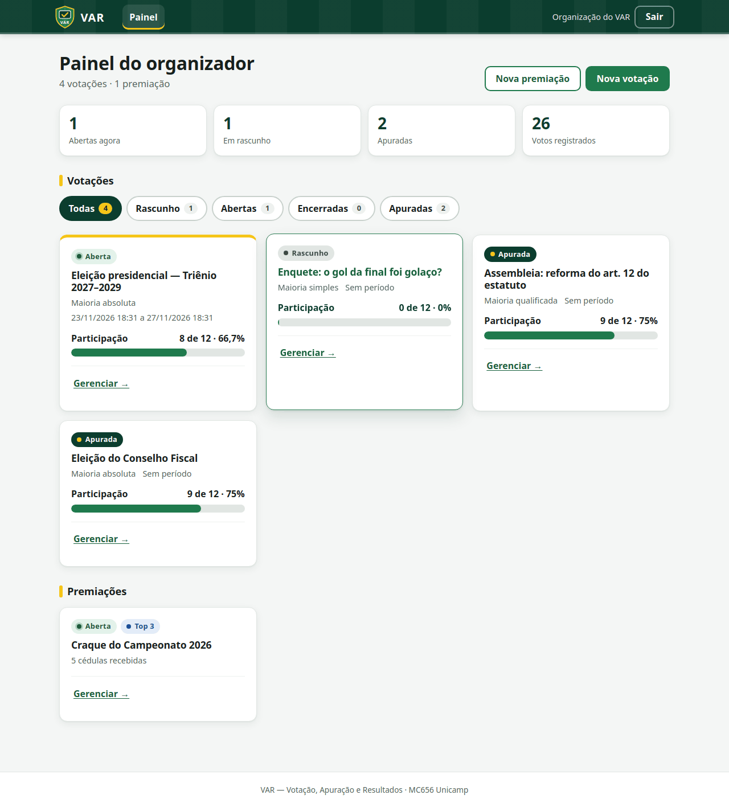

Métricas (abertas, em rascunho, apuradas, votos registrados), votações filtradas por status e as
premiações. Cada card leva à gestão.

### 2.2 Nova votação

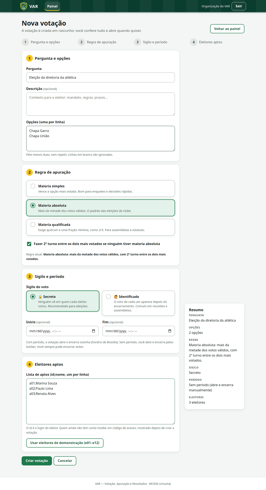

Em quatro blocos:

1. **Pergunta e opções:** pergunta, descrição opcional (aparece na cédula) e as opções, uma por
   linha.
2. **Regra de apuração:** maioria simples, absoluta (com 2º turno opcional) ou qualificada (quórum e
   fração).
3. **Sigilo e período:** sigilo secreto ou identificado; início e fim, opcionais.
4. **Eleitores aptos:** a lista, no formato `id;nome`.

O resumo ao lado descreve a regra escolhida. A votação é criada em **rascunho**.

### 2.3 Códigos de acesso

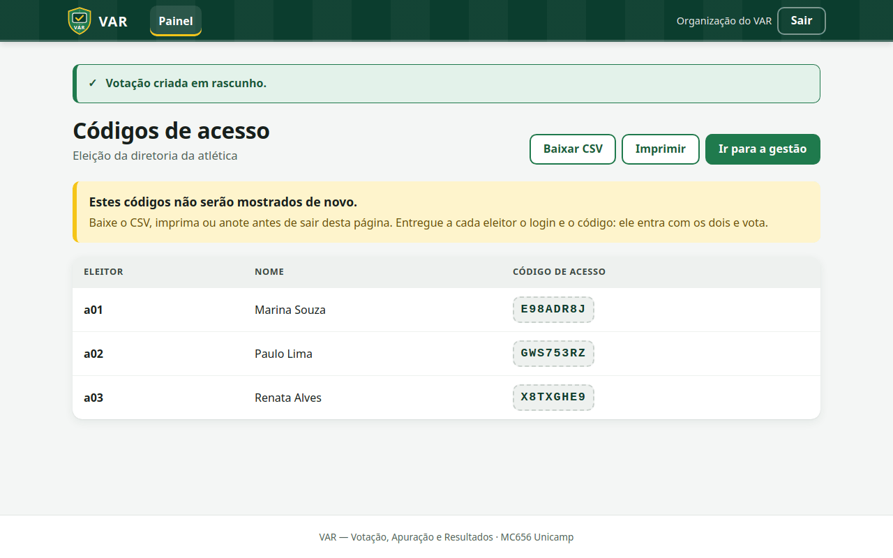

Cada eleitor novo da lista ganha uma conta, com login igual ao id e um código de acesso. Os códigos
aparecem **uma única vez**: baixe o CSV ou imprima antes de sair da página.

### 2.4 Gestão ao vivo

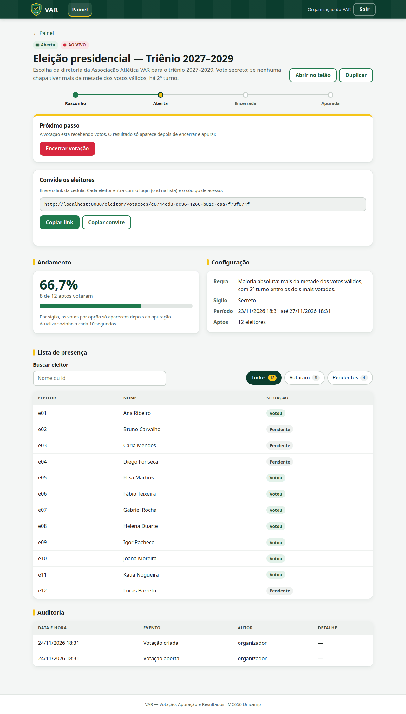

- A linha do tempo mostra o estado: Rascunho → Aberta → Encerrada → Apurada.
- **Próximo passo:** a ação permitida no estado atual (abrir, encerrar, apurar). Cada ação pede
  confirmação.
- **Convide os eleitores:** o link da cédula e o texto do convite, para copiar.
- **Andamento:** participação, atualizada a cada 10 segundos. Por sigilo, os votos por opção só
  aparecem depois da apuração.
- **Lista de presença:** quem já votou, com busca e filtros. Nunca mostra a escolha numa votação
  secreta.
- **Auditoria:** cada evento, com data/hora e autor.

Em rascunho, ainda dá para trocar a regra de apuração. "Duplicar" cria uma votação nova com a mesma
configuração, e "Abrir no telão" leva à versão para projetar.

### 2.5 Segundo turno

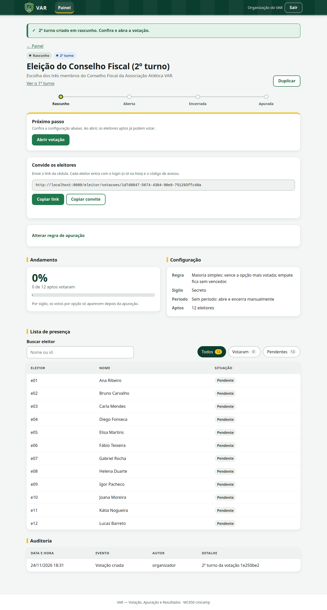

Quando a maioria absoluta com 2º turno não tem vencedor, a gestão oferece "Criar 2º turno". A nova
votação nasce em rascunho, com as duas opções mais votadas, maioria simples e o mesmo eleitorado, e
traz o link "Ver o 1º turno".

### 2.6 Premiação Top 3

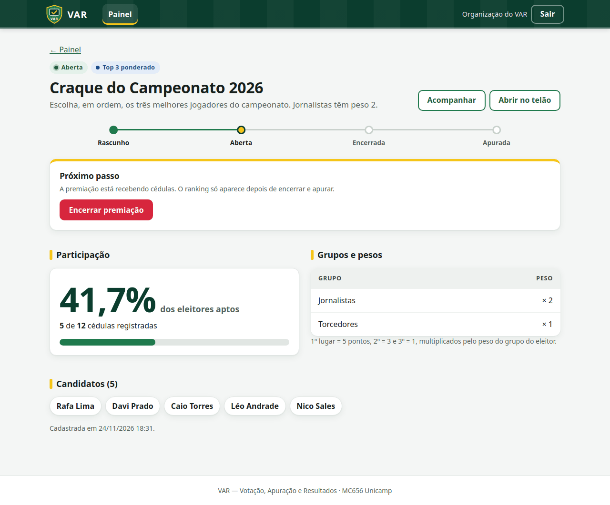

A premiação tem candidatos, grupos de votantes com pesos (ex.: Jornalistas × 2, Torcedores × 1) e a
lista de quem vota em cada grupo. A gestão mostra a participação; o ranking só sai depois de
encerrar e apurar.

## 3. Eleitor (celular)

| Painel | Cédula | Revisão |
|---|---|---|
| 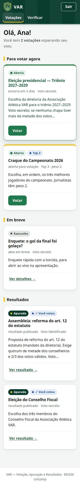 | 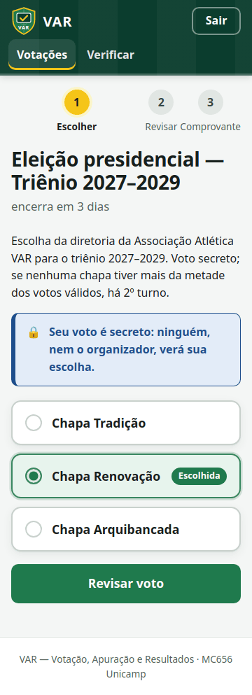 | 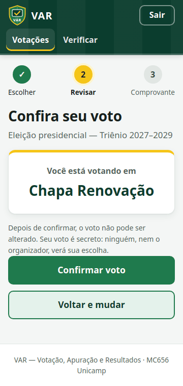 |

- **Painel:** as votações em que o eleitor é apto, separadas em "Para votar agora", "Já votei",
  "Em breve", "Aguardando apuração" e "Resultados", com o prazo de cada uma.
- **Voto em 3 telas** (RNF-04):
  1. a **cédula**, com o aviso de sigilo e as opções em cartões grandes;
  2. a **revisão** ("Confira seu voto"), com "Voltar e mudar";
  3. o **comprovante**.

| Comprovante | Verificar | Cédula Top 3 |
|---|---|---|
| 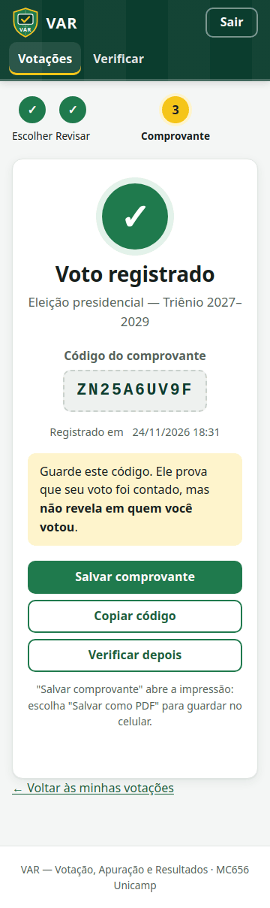 | 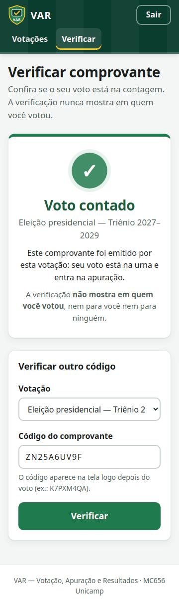 | 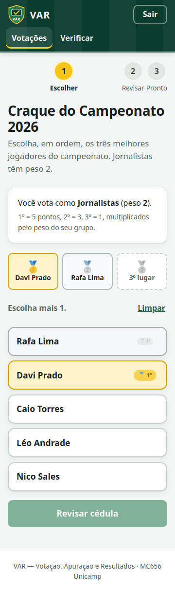 |

- **Comprovante:** código único com data e hora, mostrado uma vez, sem a opção escolhida. Os botões
  são "Salvar comprovante" (impressão ou PDF), "Copiar código" e "Verificar depois".
- **Verificar** (`/verificar`, público): confere se o código foi emitido pela votação, sem revelar o
  voto.
- **Cédula Top 3:** o eleitor toca nos jogadores na ordem 1º, 2º e 3º; a tela mostra o grupo e o
  peso. Sem JavaScript, a cédula vira três seleções.

## 4. Resultados

### 4.1 Resultado e Momento VAR

| Momento VAR | Resultado |
|---|---|
| 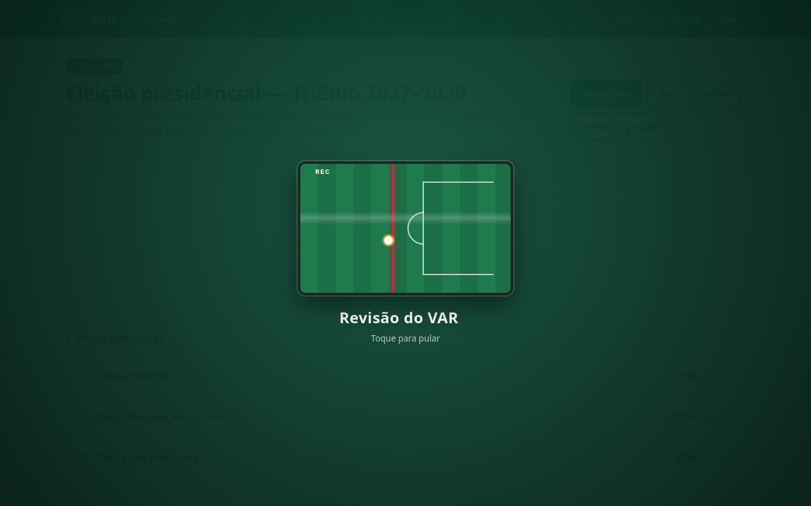 | 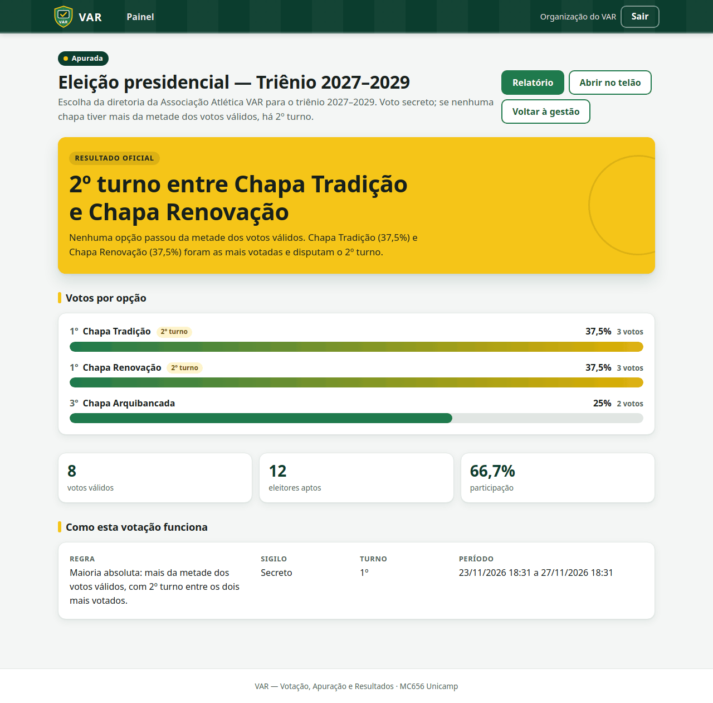 |

Ao abrir o resultado de uma votação apurada, uma animação curta ("Revisão do VAR...") antecede a
faixa com a situação. Clique ou Esc pulam a animação. A tela mostra a situação (eleito, 2º turno,
sem vencedor ou quórum não atingido), as barras com votos e percentuais, a participação e as regras
da votação.

### 4.2 Relatório (ata)

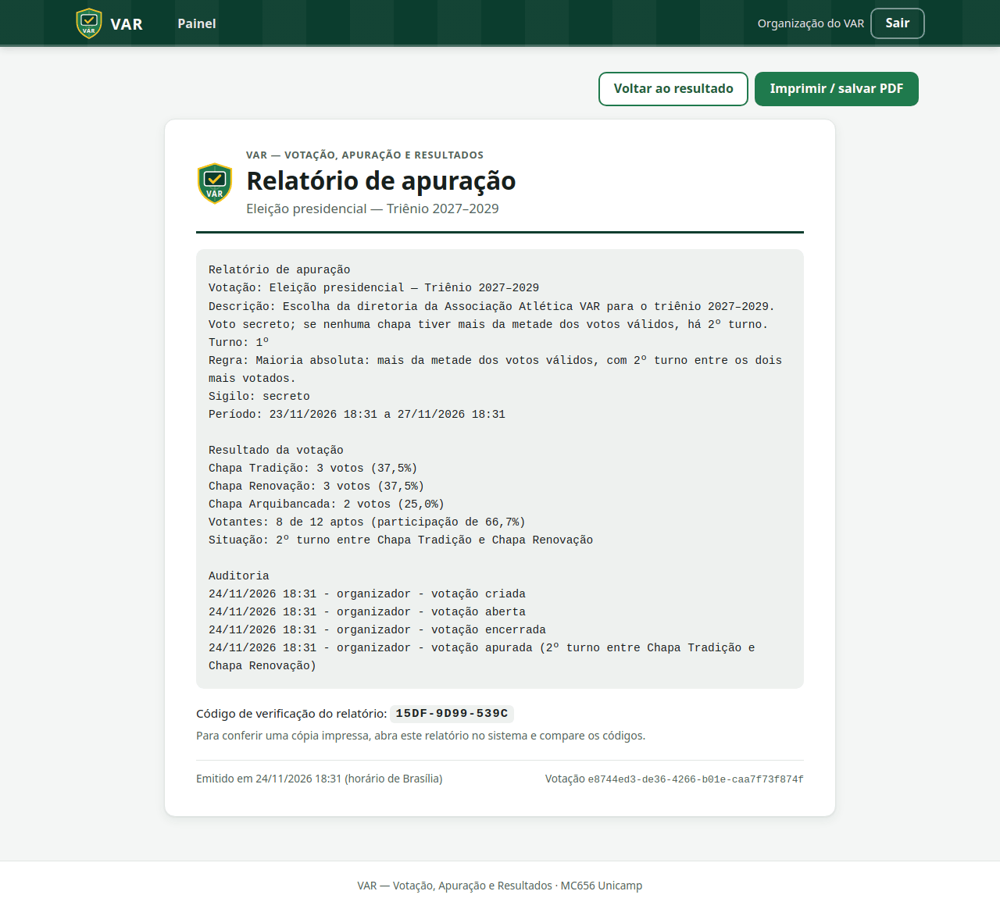

O relatório traz a pergunta, a regra, o sigilo, o período, o resultado e a trilha de auditoria,
pronto para imprimir ou salvar em PDF. O **código de verificação** é o início do SHA-256 do texto:
quem tiver uma cópia impressa abre o relatório no sistema e compara os códigos. Ele detecta uma ata
alterada; não é assinatura digital.

### 4.3 Ranking da premiação

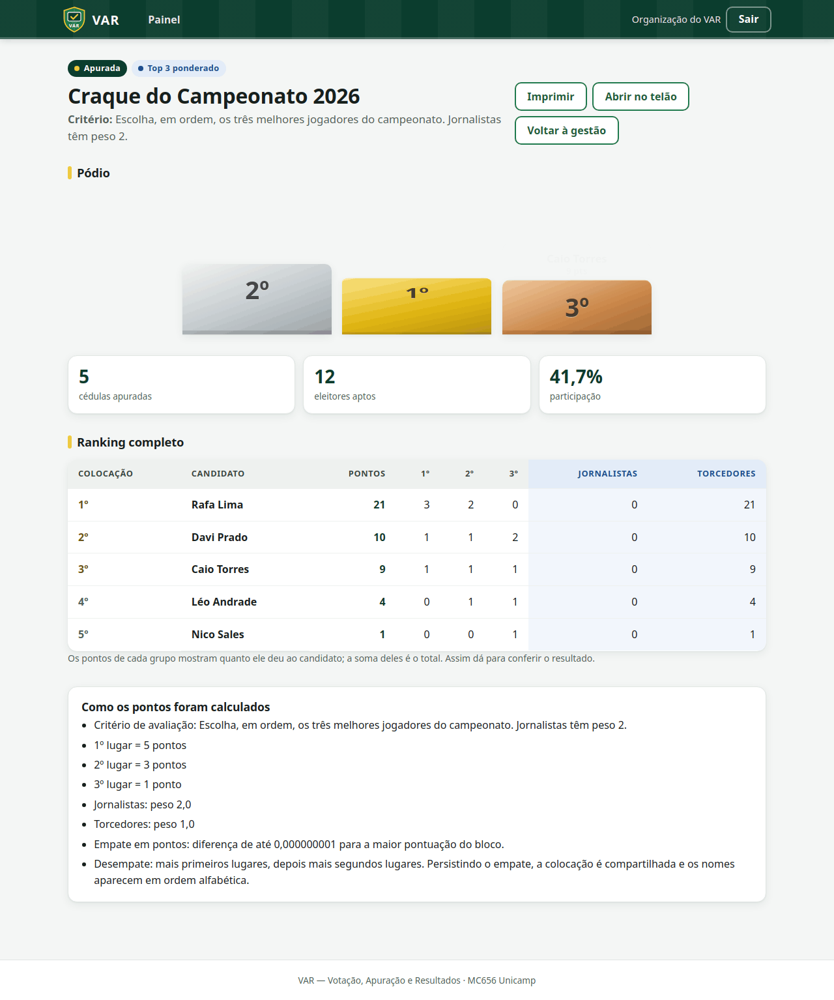

Pódio, ranking completo com os pontos, as vezes em 1º, 2º e 3º e os pontos vindos de cada grupo
(a soma dos grupos dá o total), e o texto dos critérios de cálculo e de desempate.

### 4.4 Telão

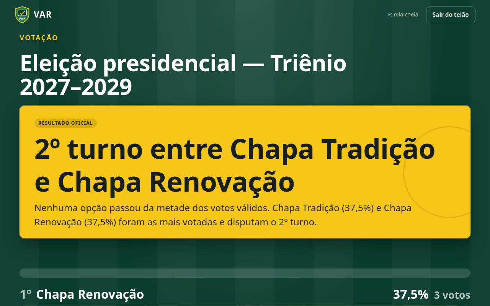

Versão para projetar (`/votacoes/{id}/telao` e `/premiacoes/{id}/telao`): letras grandes, revelação
das barras e tela cheia com a tecla F. Antes da apuração, mostra só a participação.
